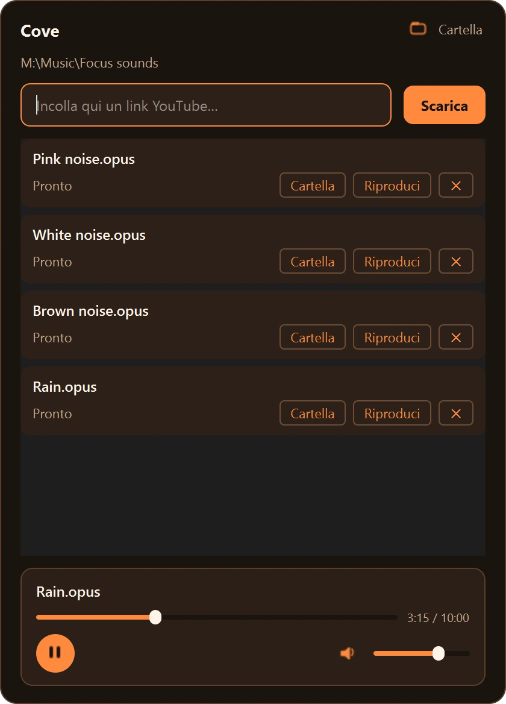

<p align="center"></p>

<h1 align="center">Cove</h1>

<p align="center"><strong>A system-tray player for background audio, for Windows.</strong></p>

<p align="center">
  <a href="https://github.com/caste9612/Cove/releases/latest"></a>
  
  <a href="LICENSE"></a>
</p>

To have white noise or rain while working, I had to keep the video open in a browser tab, with ads and
interruptions. Cove downloads the audio of a YouTube link once, at its original quality, and plays it from a
small panel in the system tray, also with the media keys.

<p align="center"></p>

## Download

Download `Cove-Setup-X.Y.Z.exe` from the [latest release](https://github.com/caste9612/Cove/releases/latest)
and run it. It installs in `%LOCALAPPDATA%\Programs\Cove` without administrator rights and can start Cove at
login.

- **Windows 10 or 11**, 64-bit.
- The installer includes everything Cove needs, Python and its libraries too, which is why it is larger than
  a small app usually is.
- The interface is in Italian.

## What it does

- **Tray panel**: a click on the tray icon opens a panel in the bottom-right corner; there is nothing else to
  open.
- **Original quality**: the audio is kept in its original format (Opus, about 160 kbps), without being
  converted again. A link copied to the clipboard is offered when the panel opens.
- **Mini player**: play, pause, seek and volume inside the panel.
- **Media keys**: the play and pause keys of keyboards and headphones control Cove from anywhere.
- **Library**: every downloaded file stays available in the panel. Everything lives in the installation
  folder, nothing in `Music` or `AppData`.
- **Built-in sounds**: two kinds of white noise, a drone and rain, generated with FFmpeg.

## Build from source

You need Windows 10 or 11, the official Python 3.11 (not Anaconda, see `tools/prepare_runtime.py`),
[Inno Setup 6](https://jrsoftware.org/isdl.php) for the installer and FFmpeg to regenerate the built-in
sounds.

```powershell
py -3.11 -m venv .venv
.\.venv\Scripts\activate
pip install -r requirements.txt
python app.py                        # run from source

python tools\prepare_runtime.py      # embedded runtime (once, and after updating the dependencies)
python tools\build.py --installer    # installer in dist\Cove-Setup-X.Y.Z.exe
python tools\make_presets.py         # regenerate the built-in sounds
python tools\make_icon.py            # regenerate the icon
```

How it is put together:

- `Cove.exe` is a small launcher (PyInstaller, without Qt) that starts `runtime\pythonw.exe app.py`. This
  avoids DLL clashes on PCs with Anaconda in the PATH, whose old `msvcp140`/`concrt140` collide with PySide6.
- `runtime/` is the official embedded Python with PySide6 and yt-dlp, without the Qt modules Cove doesn't use
  (about 305 MB instead of 700).
- `app.py` plays Opus and WebM through QtMultimedia's FFmpeg backend, so it doesn't depend on the codecs
  installed in Windows.
- The media keys go through `RegisterHotKey` and a `QAbstractNativeEventFilter` on `WM_HOTKEY`.

```
Cove/
├── app.py            # the app (PySide6)
├── launcher.py       # the wrapper compiled into Cove.exe
├── audio/            # the built-in sounds
├── runtime/          # embedded Python + PySide6 + yt-dlp (versioned)
├── tools/            # build, runtime, presets and icon scripts
├── cove.iss          # Inno Setup script
└── VERSION
```

## License

[MIT](LICENSE)
